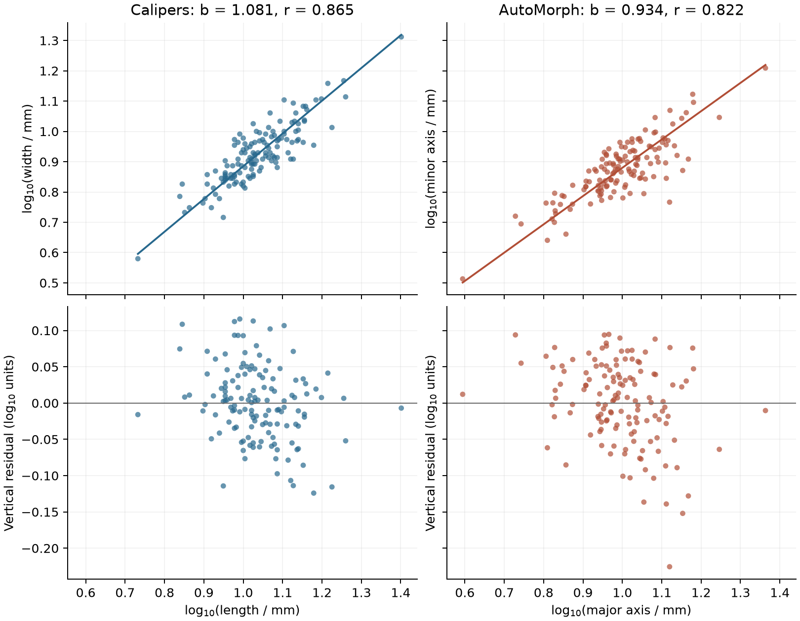

# Fossil limpet scaling depends on how the shells are measured

The caliper and AutoMorph descriptions of the same **136 fossil
*Lottia edmitchelli*** give log–log RMA exponents of **1.081** and **0.934**,
respectively. The point estimates lie on opposite sides of 1. Thus the
description of relative widening or narrowing with size depends on the
measurement definition. These are descriptive estimates: neither a departure
from isometry nor a difference between the two exponents has been tested.
[API fields: `fits.caliper_log.slope`, `fits.automorph_log.slope` in
[results.json](results.json).]

Caliper width and length are positively associated, with log-scale Pearson
**r = 0.865**; the corresponding AutoMorph correlation is **0.822**. The
fitted lines summarize substantial specimen-level scatter. This one archived
sample does not establish how individual limpets grew, which measurement
method is more accurate, or the population's allometric exponent.



Both columns contain the same ObjectIDs, with shared plotting scales. Top:
saved specimen measurements and API RMA lines. Bottom: saved vertical
residuals. Each dot retains its identity in [api-pairs.csv](api-pairs.csv).
The figure reformats API fields; it fits no additional line.
[Vector PDF](figures/scaling.pdf).

## The two fixed fits

The study ran unchanged from the design frozen at `39815c3` and approved in
Board 3117. The main fit uses caliper length as x and width as y; the
sensitivity uses AutoMorph major as x and minor as y. Both variables are
log10 transformed, with no filtering or imputation.

| Measurements | Retained n | Log-scale r | Exponent b | Log intercept a | Vertical residual RMSE |
| --- | ---: | ---: | ---: | ---: | ---: |
| Calipers | 136 | 0.864698 | 1.080737 | −0.195825 | 0.051360 |
| AutoMorph | 136 | 0.822180 | 0.933878 | −0.053930 | 0.057694 |

All entries are from `results.json: fits.<analysis_id>` fields `n`,
`correlation`, `slope`, `intercept` and `vertical_residual_rmse`.
RMSE and intercept are in log10 units. The intercept describes fitted log
width at a length of 1 mm, outside both observed length ranges; it is not a
width/length ratio. Vertical residuals are descriptive diagnostics, not an
OLS fitting objective.

| x measurement | Minimum (mm) | Maximum (mm) | Maximum/minimum |
| --- | ---: | ---: | ---: |
| Caliper length | 5.40 | 25.20 | 4.667 |
| AutoMorph major axis | 3.93 | 23.09 | 5.875 |

The spans come from `length_span_mm` in `results.json`, calculated only from
the inspected `pairs[].x_raw` fields. They describe the support for each
line. They do not establish representative sampling throughout either range.

Both fits retained all input specimens (`n_input = n = 136`), with empty
`excluded` and `warnings` lists. In particular, neither fit returned the
anticipated `repeated_pairs` warning: individual rounded dimensions may
repeat without an entire length–width pair repeating.

The RMA magnitude is the ratio of the two sample SDs. The correlations and
scatter therefore matter alongside the exponents. No uncertainty interval,
isometry p-value, slope-difference test or multiple-testing family is reported.
The methods are paired observations of the same shells, not independent
biological samples. Their axes also embody different measurement definitions.

## Recorded precision and source limits

Every archived measurement is printed with two decimal places. All caliper
values lie on a **0.1 mm grid**; AutoMorph values include nonzero hundredths
and are stored in **0.01 mm increments**. These facts describe the CSV's
representation, not measurement accuracy.

The [source methods, pp. 8–9](https://finneganlab.org/wp-content/uploads/2024/08/hsiang-et-al-2018-supplemental.pdf)
state a caliper resolution of **0.1 mm** and a typical AutoMorph resolution
of **0.001 mm**. The published AutoMorph resolution is finer than the
archived decimal step. Digit count alone does not establish instrument
resolution or error. The present analysis preserves the stored numbers and
does not isolate rounding from axis definition, imaging or specimen matching.
[Recorded checks: `measurement_precision` in `results.json`.]

The [frozen dataset](https://zenodo.org/records/1002768) contains one sample
label, `Edmitchelli_LAMNH12577_lot_4`, and unique ObjectIDs. The source
methods identify the shells as Pleistocene *L. edmitchelli* from San Nicolas
Island, LACMIP locality 12577. ObjectIDs were visually matched to physical
shells for hand measurement. This application accepts those matches; the
source images and shells were not re-examined.

The supplement describes **139** shells, while the available CSV contains
**136**. This discrepancy remains unexplained. No absent records were
reconstructed. Collection, preservation and selection into a method-checking
sample can affect the size–shape relationship. No within-method replicate
measurements are provided to estimate measurement-error variance.

Published caliper-versus-AutoMorph calibration results were encountered
before the design freeze and disclosed then. Those regressions differ from
these two width–length fits. This application is not a blinded study or an
independent validation of AutoMorph.

## Verification and reproducibility

The study and both child bundles pass toolkit inspection. A copy was moved
to a temporary location and reproduced in a fresh Python process with
`Path.open` reads from the original application directory blocked. The guard rejected a
deliberate original-input probe, and reproduction then made **zero** such
read attempts. Both child `results.json` files and the derived preparation
were byte-identical. A second fresh-process execution of the complete
analysis reproduced `results.json`, `api-pairs.csv` and `api-scalars.csv`
byte for byte. [Receipt](reproduction-check.json).

A separately written base-R implementation independently log10 transformed
the saved raw pairs and checked **834 quantities**: 18 scalar values and
816 transformed specimen values/residuals. All passed
`abs(R − API) <= 1e-10 + 1e-10 * abs(API)`. The maximum absolute difference
was **4.44 × 10⁻¹⁶**. This checks arithmetic under matched conventions; it
does not establish a scientifically representative sample or the validity
of an inferential model. [Reference code](reference.R),
[all comparisons](r-reference.csv), [R 4.6.1 receipt](r-check.json).

No toolkit engine changes were needed or made. The full engine suite was not
rerun for this application; the checks above exercise the actual study,
portability, numerical exports and independently implemented arithmetic.

From a fresh checkout, run:

```sh
uv run analyses/fossil-limpets/analysis.py
uv run analyses/fossil-limpets/reproduce.py
Rscript --vanilla analyses/fossil-limpets/reference.R
uv run analyses/fossil-limpets/figures.py
```

The first command calls the frozen intake automatically. Study output
directories must be fresh; for another launch use
`--output analyses/fossil-limpets/runs-next`. The reproduction script makes
a fresh export-check directory itself. Regenerable bundles are gitignored.
Run locations, IDs, source fingerprints and package versions are recorded
separately in [provenance.json](provenance.json). The canonical numerical
record contains no run IDs.

## Steps outside the toolkit

| Subtask | Why the toolkit could not do it | What was used instead | How checked |
| --- | --- | --- | --- |
| Make ObjectID the row key and separate the sample label | The source key is its second column, and the reader has no declared ID-column/measurement-column selection | Frozen `intake.py`, copying source strings | Source SHA-256 and registered MD5; every ID/cell matched; toolkit table read-back and preparation |
| Establish source provenance, units and the 139/136 discrepancy | The API does not interpret source documentation | Archive metadata and source methods | Original source label and object IDs preserved; relevant methods pages checked |
| Check structural feasibility without a pre-review fit | RMA validation computes the fit as part of checking numerical requirements | Schema and source-field checks | Pre-results intake receipt and fitting-call guards; this is study discipline, not a toolkit defect |
| Report raw length spans and max/min ratios | RMA returns the pairs but no range fields | `min`, `max` and division on inspected `pairs[].x_raw` | Endpoints matched to source cells and ratios checked with Decimal arithmetic; fields included in the byte-identical numerical record |
| Report recorded precision | RMA uses numbers and does not retain decimal text or infer instrument resolution | Decimal-text checks and source-stated resolution | Original CSV and published methods; representation kept separate from accuracy |
| Independently check arithmetic | An independent implementation is outside the analysis API | Base R, using saved raw pairs | 834 comparisons at the declared tolerance; API values retained |
| Isometry inference, intervals and paired slope comparison | The current RMA method is descriptive | Declined | Report limited to point estimates and specimen scatter |

## What the application adds

This is the first real-data use of the toolkit study layer's `measurements`
input. It completed the two declared fits and their portable reproduction
without exposing a numerical defect. The scientific result is a useful
limit: even the point-estimate direction relative to isometry changes with
measurement definition, and the present toolkit cannot quantify uncertainty
in that comparison.

[toolkit-gaps.json](toolkit-gaps.json) records three needs: declared input-ID
and measurement columns; RMA uncertainty and fixed-slope inference; and
convenient measurement ranges. A methods contract for RMA inference is the
strongest scientific next step. Independent-group common-slope methods would
not answer this application's paired comparison; that requires its own
design. No inference feature is implemented here.

Codex (GPT-6.1 Sol) prepared and executed this application; a Codex delegate
wrote the independent base-R check. Claude (Opus 5.5) reviewed and approved
the design and requested the additional reporting fields. Barry W. Brook
directed the research-application programme. The original dataset creators
are credited in [source/source.json](source/source.json), with the unchanged
data redistributed under CC BY 4.0.

Primer **0.2.0.dev0**, full SHA-256:
`089a91663185ebff31e358a7e4c5f34e899336d1d1f26c0032f7a17f54c49e99`.
