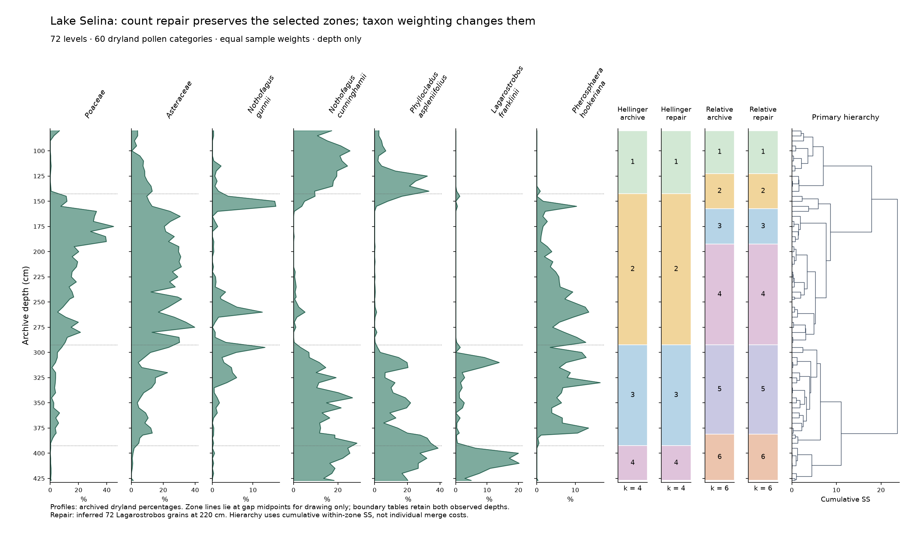

# Lake Selina zonation is stable to count repair but sensitive to taxon weighting

The fixed primary procedure selects **four zones**, separated at archive
**140–145, 290–295 and 390–395 cm**. Adding the previously inferred 72
*Lagarostrobos franklinii* grains at 220 cm leaves all three selected
boundaries unchanged. Using relative abundances instead of their square
roots selects **six zones**, with only **290–295 cm** retained as exactly
the same sample gap. The count repair also leaves those six zones unchanged.
For these two declared sensitivities, taxon weighting matters more to the
selected partition than the single inferred count.

This is a descriptive summary of one reused archive, not a discovery of
dated events or a test of the number of ecological zones. Fields are
`coniss.<analysis>.retention`, `.boundaries` and `.zones` in
[results.json](results.json). Both the original and reconstructed counts
remain conditional working inputs; the inferred count is not verified.



Profiles show the seven categories fixed before analysis, using archived
dryland percentages supplied by the community API. Each zone column shows
that run's own selected partition, numbered from the top of the record.
Colours and numbers do not identify corresponding ecological units across
columns. Horizontal lines are primary boundaries drawn at gap midpoints;
they do not locate a change more precisely than the bracketing samples.
The hierarchy uses cumulative within-zone SS, because individual constrained
merge costs need not increase. [Vector PDF](figures/zonation.pdf).

## Boundaries and the common four-zone comparison

| Counts and coordinates | Selected zones | Boundary brackets, archive cm | Exact primary gaps retained |
| --- | ---: | --- | ---: |
| Archived, Hellinger (primary) | 4 | 140–145; 290–295; 390–395 | 3 of 3 |
| Reconstructed, Hellinger | 4 | 140–145; 290–295; 390–395 | 3 of 3 |
| Archived, relative abundance | 6 | 120–125; 155–160; 190–195; 290–295; 380–382 | 1 of 3 |
| Reconstructed, relative abundance | 6 | 120–125; 155–160; 190–195; 290–295; 380–382 | 1 of 3 |

Persistence requires the **same two sample IDs**, not proximity in depth.
The primary gaps are 531309/531310, 531346/531347 and 531367/531368.
All retained gaps, IDs, ranks and alternative cuts are in
[boundaries.csv](boundaries.csv). The one shared gap is 531346/531347.

At the primary **k = 4**, both relative-abundance hierarchies cut at
**155–160, 290–295 and 380–382 cm**. The first is three sample gaps deeper
than the primary 140–145 gap, a shift of **+15/+15 cm** in its two bracket
ends. The last is three gaps shallower than 390–395, or **−10/−13 cm**.
Thus even with zone count held fixed, two of three selected boundaries
change location. Fields: `comparisons.common_primary_k`; full offsets are
in [boundary-offsets.csv](boundary-offsets.csv).

At their selected six-zone cuts, the relative runs additionally place gaps
at 120–125 and 190–195 cm. Under the frozen nearest-gap rule, these are
associated descriptively with primary 140–145: respectively −4 gaps
(−20/−20 cm) and +10 gaps (+50/+50 cm). Together with 155–160, this makes
three sensitivity gaps associated with one primary gap. These many-to-one
associations are bookkeeping, not evidence that a single ecological event
moved or split.

The primary zones contain **13, 30, 21 and 8 levels**, spanning sampled
depths **80–140, 145–290, 295–390 and 395–427 cm**, respectively. Their
selected membership is unchanged by imputation. The within-zone sums of
squares and merge costs do change; stability here concerns the
reported cuts, not identical numerical results or every possible k.

The primary broken-stick passing prefix stops at split rank 4: gain
**0.98114** falls below expectation **1.00338**. The first three pass.
Relative abundance stops at rank 6, selecting six zones. Later exceedances
are saved but do not restart the fixed prefix rule: ranks 66–71 for both
Hellinger runs, rank 71 for archived relative abundances, and ranks 70–71
for reconstructed relative abundances. All 284 comparisons are in
[broken-stick.csv](tables/broken-stick.csv). This is a heuristic
retention convention, not a significance test or a globally optimal
segmentation. Fields: `.broken_stick` and `.retention`.

## Ecological reading and its limits

The plotted pollen categories retain the broad succession already seen in
the earlier application: basal forest, an intervening herb-rich interval,
and upper forest. The primary 140–145 cm boundary lies inside the previously
reviewed forest-rise interval, candidate archive 135–155 cm. Relative
abundance instead separates 155–160 cm, the largest adjacent compositional
step in the earlier analysis, and adds a 190–195 cm boundary within the
candidate herb-rich interval (155–200 cm). This same-data agreement provides
context; it is not independent validation against the published zones.
The two paper landmarks and seven plotted categories were locked in
[context.json](context.json) before zonation.

Square-root proportions reduce the leverage of dominant categories relative
to proportions themselves. The resulting partition difference shows that a
single automatic zonation does not determine uniquely resolved vegetation
boundaries. Neither transform is selected as the ecological truth by this
comparison. No post-hoc taxon removal, revised pollen sum or alternative k
search was performed.

All depths here are the **archive's**. The earlier paper review supports a
candidate +30 cm sample-depth alignment, but this application neither proves
a universal offset nor rebuilds a chronology. No ages, durations, rates or
human/climatic event attributions are estimated. Broad and genus-level
archive categories remain separate and should not be read as species counts.

All four CONISS runs have **no exclusions and no numerical warnings**.
The method is greedy, gives every level equal weight regardless of physical
spacing, and does not propagate counting error or sampling uncertainty.
It supplies no boundary intervals or p-values. Numerical repeatability
cannot establish ecological validity.

The separate graphics-only community run reports **31 material negative
PCoA eigenvalues**, with negative inertia magnitude **0.97137**, without
correction. No ordination coordinates or diversity estimates are interpreted
here; the figure uses its row proportions only. Those proportions do not
depend on the PCoA geometry. Full warning details and descriptive limitations
are retained under `plot.warnings` and `plot.limitations`.

## Fixed design, checks and toolkit use

The executable [design](DESIGN.md), four-run specification, graphics-only
specification, input hashes, fixed plotting context and reference scripts
were committed at **20c68c2** before the first core zonation. No frozen
setting was altered after execution. The engine repairs at **c38696d** were
accepted first: the three rehashed tamper probes are refused and the full
suite independently passed **907 tests, with 11 skipped**. See
[repair-check.json](repair-check.json).

The saved-Neotoma reader extracted 72 levels × 66 categories; a study drops
the six declared sedge/aquatic categories, leaving the same 60-category
dryland table used previously. Its derived archived table also matches the
graphics-only study byte for byte. The reconstructed table differs only by
the declared 0→72 cell at sample 531331. Intake assertions, validation and
source hashes are recorded in [intake-check.json](intake-check.json) and
[input-lock.json](input-lock.json). The earlier Lake Selina files were not
edited.

Every native study and child bundle inspected as verified. Fresh-worker
reproduction from copied bundles gives **byte-identical results for all
five child runs** (four zonations and the graphics-only community run),
identical derived tables and a reproduced extraction. A tested `Path.open`
guard recorded zero attempted reads under either original application
directory during reproduction. [Reproduction receipt](reproduction-check.json).
This tests the bundle workflow used here; it is not an operating-system
access sandbox.

An independently written exact rounder checked all **17,280 canonical
coordinates**. Pinned **rioja 1.0-7** agreed on **856 numerical comparisons**
(maximum absolute difference **3.55 × 10⁻¹⁵**, tolerance rtol 10⁻¹⁰,
atol 0), **284 split ranks**, and **20,736 sample memberships across every
k**. All **288 retention comparisons/selected-count checks** agreed, with
no discrepancies or small-margin flags. The selected count is the declared
prefix rule applied to R's gains and expectations; rioja does not itself
return a selected k. These are arithmetic checks, not ecological validation
or sampling-coverage checks. [Reference receipt](reference-check.json),
[Python](reference.py), [R](reference.R).

| Part | Toolkit route or work outside the toolkit | Check |
| --- | --- | --- |
| Saved download to count table | `neotoma_extract`, `inspect_neotoma` | Frozen hash; previous table matches |
| Six-category removal and depth join | Study `exclude_taxa`, metadata join | 72 ordered levels, 60 categories; no exclusions |
| Four hierarchies and retained zones | Study `coniss` | Native inspection; fresh reproduction; independent rounding and R |
| Percentages for the fixed profiles | Separate study `community` | Primary derived table matches exactly |
| Metadata field projection | Outside API: select ID and archive depth columns | Exact ID/Decimal depth match to existing levels |
| Boundary correspondence and offsets | Outside API: declared ID matching and nearest-gap bookkeeping | Exported brackets, IDs and signed offsets are auditable |
| Figure layout and scientific interpretation | Outside API: draw native fields; interpret with locked context | Visual inspection; no fitted result recalculated |
| Independent reference | Outside API by design | Independent coordinate rounding; pinned R implementation |

No new engine defect was encountered. This application successfully uses
the new stratigraphic method, while exposing the substantive sensitivity
that the fixed design was intended to measure. No further toolkit addition
is required to interpret these results.

## Re-run

Install the Python project with `uv` and restore the pinned R reference
library as described in [the R setup instructions](../../references/r/README.md)
before running `reference.py`. The toolkit itself does not require R.

```bash
uv run palaeo-agent primer
uv run analyses/lake-selina-zonation/prepare.py
uv run analyses/lake-selina-zonation/analysis.py --output analyses/lake-selina-zonation/runs-study-new
uv run analyses/lake-selina-zonation/reproduce.py
uv run analyses/lake-selina-zonation/reference.py
uv run analyses/lake-selina-zonation/figures.py
```

Choose a fresh output directory. Native bundles and bulk reference
intermediates are regenerable and ignored by Git. Stable exported results,
boundary tables, receipts and the figure are committed. Transient bundle
IDs and environment hashes are in [provenance.json](provenance.json).
The versioned primer was read in full before analytical work:
**0.2.0.dev0**, SHA-256
`fcc02a57db1ffa2a86d14e7c2540bd7bfa89c14e7e5b3334286f9a24b16747f6`.

Codex GPT-6.1 prepared and executed the frozen study, reference checks,
reproduction, figure and report. Claude Opus 5.5 implemented the method and
reviewed the design. Barry Brook supplied the source-paper access, scientific
direction and authority to proceed. The method is documented with verified
references in [the sprint-14 contract](../../docs/sprint-14-contract.md).
