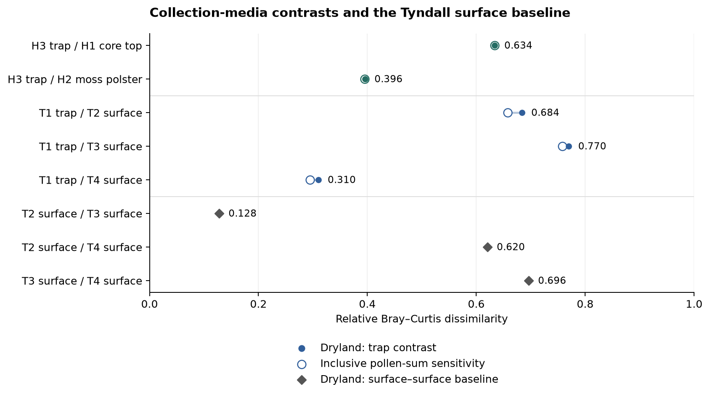
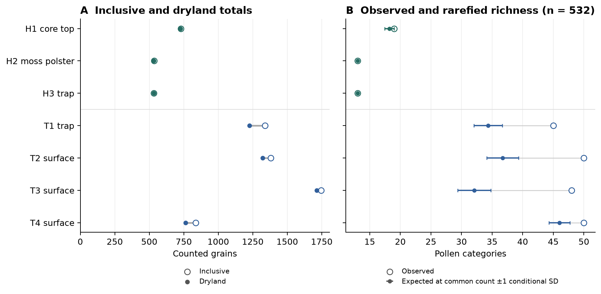

# Surface variation at Tyndall overlaps the pollen-trap contrasts

The Tyndall trap differs from its three surface records by Bray–Curtis
distances of **0.310–0.770**. The surface records themselves span
**0.128–0.696**. Thus substantial differences occur within one medium as
well as between media. These seven archived records do not identify a
general collection-medium effect. Hartz's trap differs from its core top
by **0.634** and its moss polster by **0.396**, but Hartz has no same-medium
reference. [Fields: `primary_community.distances`, mapped in
`primary_pair_distances` in [results.json](results.json).]

Standardising to **532 dryland grains** removes T3's observed richness lead
over the trap. The conditional subsampling ranges for the trap, T2 and T3
overlap; T4 has the highest expected category richness. This supports no firm
ordering among the first three, and is neither a test of population richness
differences nor evidence of equivalence. At Hartz, the moss and trap are
already at almost the common count, so rarefaction adds little information
about their richness comparison.



Filled circles are primary dryland distances; open circles retain the three
excluded sedge/rush categories. Diamonds are the separate Tyndall surface
baseline. H and T denote Hartz and Tyndall; numbers are archived sample indices,
not depths or times. [PDF](figures/pair-distances.pdf).

## Magnitudes and taxon differences

The five trap comparisons and the three baseline pairs were fixed before
results. Every omnibus comparison exceeds the conditional counting model,
including the closest surface–surface pair. The effect sizes provide the
useful distinction:

| Contrast | Primary Bray–Curtis | Inclusive sensitivity | Omnibus Holm p | Taxa passing the run's taxon Holm correction |
| --- | ---: | ---: | ---: | ---: |
| H3 trap / H1 core top | 0.634 | 0.634 | 0.00005 | 9 |
| H3 trap / H2 moss polster | 0.396 | 0.395 | 0.00005 | 4 |
| T1 trap / T2 surface | 0.684 | 0.657 | 0.00005 | 9 |
| T1 trap / T3 surface | 0.770 | 0.758 | 0.00005 | 11 |
| T1 trap / T4 surface | 0.310 | 0.295 | 0.00005 | 6 |
| T2 surface / T3 surface | 0.128 | — | 0.00003 | 1 |
| T2 surface / T4 surface | 0.620 | — | 0.00003 | 12 |
| T3 surface / T4 surface | 0.696 | — | 0.00003 | 13 |

Distances are from the respective community matrices. P-values and taxon
decisions are from `trap_primary.pairs`, `baseline_tyndall_surface.pairs`
and `trap_inclusive.pairs`; the taxon-count column concerns the primary sum.
The five trap rows use a 218-test taxon Holm family, while the three surface
rows use a separate 185-test family. Their significant-taxon counts are
therefore not directly comparable as measures of difference magnitude.
[Machine-readable pairs](tables/pairs.csv) and
[all significant taxon records](tables/significant-taxa.csv).

At Hartz, *Nothofagus cunninghamii* is higher in the core top than the trap
by **34.8 percentage points**, and in the moss by **24.2 points**. Poaceae
changes in the opposite direction, by **−28.4** and **−18.6 points**.
*Phyllocladus* also passes Holm in both comparisons. These differences
describe the counted assemblages; they do not establish why the media differ.

At Tyndall, the largest surface–surface shifts involve *N. gunnii*: it falls
by **53.2** and **63.8 percentage points** from T2 and T3 to T4. The same
taxon rises by **54.1** and **64.8 points** from the trap to T2 and T3, and
is the only taxon passing Holm in the close T2/T3 comparison. Thus the
within-medium variation and the largest trap contrasts share a dominant
taxon. *N. cunninghamii*, *Elytranthe* and *Phyllocladus* account for other
substantial, Holm-supported contrasts.

Local variation in *N. gunnii* abundance, including sample placement relative
to nearby plants, is a plausible explanation. The archive lacks the sample
positions and local vegetation observations needed to establish that account
or rank it against collection medium and integration time. No taxon-removal
analysis was run; such a sensitivity would need a future prospective design.

All effects above are the API's `proportion_difference_b_minus_a`, displayed
in percentage points, from the named run's `pairs[].taxon_tests`. Pair order
is the table's left sample followed by its right sample. Archived labels
are retained and describe pollen categories, including broad categories;
they are not an enumeration of plant species.

## Counting depth, richness and pollen sum

| Sample | Inclusive total | Dryland total | Observed categories | Expected at 532 | Estimated coverage at 532 |
| --- | ---: | ---: | ---: | ---: | ---: |
| H1 core top (1466027) | 728 | 727 | 19 | 18.24 | 0.9948 |
| H2 moss (1466028) | 536 | 533 | 13 | 13.00 | 0.9981 |
| H3 trap (1466029) | 534 | 532 | 13 | 13.00 | 1.0000 |
| T1 trap (1480879) | 1,338 | 1,226 | 45 | 34.35 | 0.9776 |
| T2 surface (1480880) | 1,380 | 1,321 | 50 | 36.74 | 0.9730 |
| T3 surface (1480881) | 1,746 | 1,714 | 48 | 32.10 | 0.9739 |
| T4 surface (1480882) | 836 | 764 | 50 | 46.02 | 0.9773 |

Totals and observed richness are `inclusive_community.diversity` and
`primary_community.diversity`; estimates and resolved size are
`primary_rarefaction.samples[].estimates` and `.sizes`.
[Machine-readable sample table](tables/samples.csv).

T2 and T4 tie at 50 observed categories, but T4 retains more expected
categories at equal count. T3's observed lead over the trap (48 against 45)
disappears after count standardisation: the trap is **34.35 ± 2.34**, T2
**36.74 ± 2.59**, and T3 **32.10 ± 2.70** categories (mean ± one conditional
SD). These ranges overlap. T4 is higher at **46.02 ± 1.71**. The numerical
ordering of the first three point estimates is not a robust richness ranking;
no test of population richness differences or equivalence was performed.

At Hartz, 532 is H3's entire dryland count, giving its observed **13**
categories with zero conditional SD. H2 has only one additional grain:
**12.998 ± 0.043** categories at 532 mainly restates its observed count of
13. Rarefaction provides little additional comparison between those two.
The substantive Hartz standardisation is H1's larger count against them:
**18.24 ± 0.78** categories at the common size.



Whiskers show the API's **one conditional standard deviation**, describing
random subsampling of each observed assemblage. They are not confidence
intervals for a site's flora or a medium effect. Coverage estimates concern
abundance mass, not the fraction of taxa discovered. The full-count coverage
estimator reaches its upper boundary for H2 and H3; this does not prove
complete sampling. [PDF](figures/counts-richness.pdf).

Retaining Cyperaceae, Restionaceae and Gymnoschoenus preserves the ordering
of all five trap distances and all primary taxon decisions for the shared
categories. The inclusive run additionally identifies Cyperaceae for T1/T2
and T1/T3, and Restionaceae for T1/T3. This sensitivity does not remove the
wide overlap with the same-medium reference.

## Design, uncertainty and limits

The [amended proposal](PROPOSAL.md) was committed as **e201781** before
execution, adopting Claude's review in Board 3049. There are three separate
homogeneity runs: primary traps (**5 omnibus / 218 taxon tests**), inclusive
traps (**5 / 229**) and the primary surface baseline (**3 / 185**). Each
has its own omnibus and taxon Holm families. They do not supply one global
error guarantee across runs or test families. The repeated trap makes pairs
dependent; no ecological-replication interpretation is attached to their p-values.

Each run used **99,999 simulations, seed 20261108**. All ten trap comparisons
across the two sums, and two of the three baseline pairs, had zero simulated
exceedances: their plus-one p is the resolution floor **0.00001**. T2/T3 had
one exceedance, giving **0.00002**. Neither is an exactly known tail probability.
The built-in Holm simulation-error envelopes, which are sensitivity diagnostics,
are resolved below 0.05 for every comparison.
Two Fisher probabilities underflow float64 to 0.0: the *N. gunnii* trap/T3
test in the primary and inclusive runs. Their Holm values are also 0.0.
These are not zero probabilities and do not affect the decisions here.
Under `count_homogeneity` method version 3 (8 November 2026), these tests
carry `p_value_underflow: true` and `log10_p_value` from a log-space tail
sum: **−363.14** (primary) and **−377.45** (inclusive). The gap that
[toolkit-gaps.json](toolkit-gaps.json) records is closed. All other numerical
outputs are unchanged.
The complete native probabilities and diagnostics remain in `results.json`.

There is one trap per site, unknown exposure durations, and no precise
positions or repeat dates for the individual surface collections. Within-site
vegetation, placement and integration windows can all contribute. Tyndall's
baseline prevents a trap-specific reading of counting-error rejections;
Hartz has no equivalent reference. No PERMANOVA, age model or temporal trend
was fitted. A zero recorded taxon count means non-detection; the native
pointwise zero-count limits are saved, not evidence of ecological absence.

Primary community, rarefaction and homogeneity runs have no warnings. The
inclusive PCoA has one material negative eigenvalue, with negative-to-positive
inertia **0.000678**; it is retained without correction. Distances and counting
tests do not depend on interpreting that ordination geometrically.

## Reproduction and independent checks

```bash
uv run palaeo-agent primer
uv run analyses/pollen-media/intake.py
uv run analyses/pollen-media/analysis.py
uv run analyses/pollen-media/figures.py
uv run palaeo-agent study-inspect analyses/pollen-media/runs-study
```

Intake reads the frozen download through `neotoma_extract`. One study performs
selection, the metadata join, the declared exclusions and all six analyses.
`analysis.py` reads verified API fields; the figure/table exporter formats
those fields. Run IDs, field-bearing bundles and implementation/environment
hashes are in [provenance.json](provenance.json). The run IDs are the keys to
the field citations above; the data and design are in `data/` and `study.json`.
Regenerable source snapshots and run bundles are ignored by Git.

- A fresh Python process for each copied intake/analysis script regenerated
  `counts.tsv`, `samples.csv`, `study.json` and `results.json` **byte for byte**.
  The fresh study inspects as verified: [replay receipt](replay-check.json).
- Independent R **4.6.1**, vegan **2.7.6** and pinned iNEXT coverage agree on
  **5,540/5,540 fields** across 149 check groups. The maximum absolute error
  is **5.98 × 10⁻¹¹**, in rarefaction variance, within its declared tolerance.
  All 14 rarefaction SD/variance values pass the original method contract's
  stricter rule: absolute error at most max(10⁻¹², 10⁻¹⁰ × |reference|).
  Bray–Curtis differs by at most **3.33 × 10⁻¹⁶** and Fisher/Holm values by
  less than **2.34 × 10⁻¹⁵**. Input identities, count cells, exclusions,
  media mappings and family sizes also match: [reference receipt](reference-check.json).
- The reference recomputes scalar arithmetic and diagnostics from saved
  exceedances. It does **not** repeat the multivariate Monte Carlo draws or
  independently validate PCoA geometry. Replay and arithmetic agreement do
  not establish the scientific assumptions. The R reference records vegan's
  diagnostic that H3's smallest positive count is two.

To reproduce the optional coverage reference, obtain the official
[iNEXT 3.0.2 source](https://cran.r-project.org/src/contrib/iNEXT_3.0.2.tar.gz),
extract it, and pass its `iNEXT/R` directory to:

```bash
Rscript --vanilla analyses/pollen-media/reference.R /path/to/iNEXT/R
```

The script checks `iNEXT.r` SHA-256
`ebda76c6f9477c44141900314e94aa0a20498be015afe21877d6d26f170f7619`.
R is a validation reference, not a toolkit runtime dependency.

| Subtask | Why the toolkit could not do it | What was used instead | How checked |
| --- | --- | --- | --- |
| Interpret and transcribe collection-medium labels | The reader preserves notes but does not interpret them | Seven-row metadata mapping from archived collection-unit notes and sample indices | Matched by exact ID/index in Claude's design review (3049) and the independent source audit |
| Infer a general medium effect | These records do not justify freely exchangeable medium labels or independent medium-effect replication | Descriptive distances, the Tyndall baseline and conditional count comparisons | One trap per site and missing position/exposure metadata are explicit limits |
| Independent arithmetic validation | Independence requires another implementation under primer §7 | R vegan, Fisher/Holm/binomial calculations and the pinned iNEXT coverage function | Matched source identities and conventions; field counts/tolerances recorded in `reference-check.json` |

The primer is **0.2.0.dev0**, SHA-256
`bea68f9f65925dcbe4aeeeb2ccb7b74a0915ac4c8ce856e1b49b2e038271d5ac`.
No arithmetic discrepancy affecting a decision or additional method
requirement was found. The Fisher underflow diagnostic gap and the existing
verbose MCP extraction-inspection response remain deferred minor issues;
this application used the native Python API.

Codex (`gpt-6.1-sol`) chose and amended the design, interpreted the results,
checked reproduction and prepared this report and figures. A prescribed
execution delegate (`gpt-5.6-luna`, high effort) implemented the API pipeline;
an independent Codex delegate checked source fidelity, API use and arithmetic.
Claude (`claude-opus-5-5`) reviewed the design and proposed the effect-size and
same-medium additions. Barry W. Brook supplied project direction and oversight.
